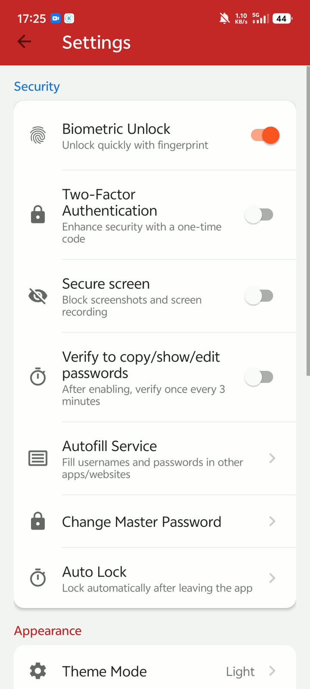

# Android 密码管理小应用

把分散在网站和应用中的账号整理成一个随时可查的本地密码本：用主密码解锁，按标题或账号搜索，复制需要的凭据；添加新账号时，可以直接生成随机密码，并补上分类、网站或应用信息。

这是一个从零搭建、由实训项目持续整理的 **Java / Room Android 小工具**，既保留日常使用的界面，也持续修复保存、搜索、密钥管理和备份恢复中的问题。当前发布为**源码开发验证版**，可自行构建体验，尚无正式签名安装包。

[功能与使用](#功能与使用) · [界面预览](#界面预览) · [操作演示](docs/DEMO.md) · [构建与运行](#构建与运行) · [验证记录](docs/VALIDATION.md)

## 界面预览

以下六图来自作者提供的**早期真机录屏**，展示应用的主要界面和交互。账号等敏感内容已遮盖；遮盖条不是原始 UI。当前源码保留以下功能，但布局、提示和认证行为可能已有调整。**旧画面里的自动填充、邮件备份入口不代表当前可用，这两项在公开版已关闭。**

<table>
  <tr><th>密码列表</th><th>随机密码生成</th><th>应用信息绑定</th></tr>
  <tr>
    <td></td>
    <td></td>
    <td></td>
  </tr>
  <tr><th>实用卡片样式</th><th>深色主题</th><th>英文界面</th></tr>
  <tr>
    <td></td>
    <td></td>
    <td></td>
  </tr>
</table>

解锁、二次验证及文件恢复的更多画面与版本差异见[操作演示](docs/DEMO.md)。当前公开版还有一张[API 36 模拟器核心流程回归截图](docs/screenshots/main-smoke.png)，使用虚构数据，与早期录像分开记录。

## 功能与使用

| 功能 | 可以怎样使用 |
| --- | --- |
| 密码记录 | 新增、编辑、删除记录；保存标题、用户名/账号、密码，以及网站或应用、分类和备注。密码默认以掩码显示，可按需查看或复制。 |
| 查找与整理 | 按标题或账号搜索；用银行、社交、购物、邮箱、工作、游戏、其他等分类标记条目。分类用于记录和展示，当前不提供分类筛选。 |
| 密码生成器 | 调整长度，选择大写字母、小写字母、数字和特殊字符，刷新生成并复制；条目编辑页也提供生成入口。 |
| 两种密码本样式 | 简约卡片突出账号、密码与复制操作；实用卡片增加分类、网站/应用、备注和“复制全部”入口。 |
| 外观与语言 | 跟随系统、浅色或深色模式；蓝、绿、紫、红四种主题色；中文、英文或跟随系统语言。 |
| 解锁与敏感操作 | 主密码解锁；提供生物识别、认证器六位动态验证码（TOTP）、敏感操作再次认证和会话期限设置。生物识别依赖设备能力与有效内存会话，进程重建后仍需主密码。 |
| 本地文件备份 | 导出加密文件，通过独立备份口令在当前库中追加恢复；导入前校验，失败不执行部分写入。具体格式、范围与限制见[文件备份与恢复](#文件备份与恢复)。 |

应用/网站绑定用于记录条目的归属，**不等于当前支持系统自动填充**。生物识别与 TOTP 有实现和早期演示，但当前版本的完整设备交互矩阵尚待验收，具体范围见[验证记录](docs/VALIDATION.md)。

### 从第一条记录开始

1. 首次使用设置主密码，之后通过解锁页进入密码列表。请先使用虚构数据体验，并妥善保存主密码。
2. 点击右下角 **＋**，填写标题、账号和密码；需要时生成随机密码，再选择网站/应用、分类并填写备注，保存条目。
3. 回到列表按标题或账号搜索；从卡片复制账号/密码、查看密码或进入编辑。开启敏感操作验证后，按提示再次认证。
4. 在设置里切换卡片样式、主题或语言；需要二次验证时，按提示在认证器中绑定并输入动态验证码。
5. 在设置中导出本地加密备份，保存独立备份口令；需要恢复时选择备份文件，核对预览数量后确认追加。建议先在测试安装中核对恢复结果。

### 当前版本范围

系统自动填充、手动/定时邮件备份在本版关闭，旧代码仅保留供后续整理；不提供云同步。录屏中这些功能曾有演示，不能据此视为当前版本的开放能力。当前可用的备份方式为本地加密文件。

## 构建与运行

需要 Android Studio 或配置好的 Android SDK、JDK 17 或更高版本。AGP 8.13.0、Gradle Wrapper 8.13、compileSdk/targetSdk 36、minSdk 28，Java 源级别 11。当前本机验证使用 JDK 23；JDK 17 尚待独立环境验证。

1. 用 Android Studio 打开根目录，通过 SDK Manager 安装 Android SDK Platform 36 和所需 Build Tools。配置 IDE 的 Gradle JDK，或设置当前 shell 的 JAVA_HOME。
2. 本地 `local.properties` 设置 `sdk.dir`，由 IDE 自动生成即可；该文件不进入仓库。不要把机器 JDK 路径写回项目 `gradle.properties`。
3. 在 Windows PowerShell 执行：

```powershell
.\gradlew.bat :app:assembleDebug
.\gradlew.bat :app:testDebugUnitTest :app:lintDebug
# 仅在用于测试的设备或模拟器上执行，会安装测试包：
.\gradlew.bat :app:connectedDebugAndroidTest
```

首次构建需要访问 Google/Maven 仓库与 Gradle 发行包地址。输出调试包为 `app/build/outputs/apk/debug/app-debug.apk`。调试签名用于开发，不作为长期分发签名。请先在测试设备使用虚构数据；不要靠卸载原应用来解决升级错误。

## 文件备份与恢复

在设置中导出前验证当前主密码，然后设置独立备份口令（至少 8 位）。请保存该口令；忘记后无法恢复。导出本身不删除记录。

新格式 v3：随机盐、PBKDF2-HMAC-SHA256 派生密钥、AES-GCM 认证加密。恢复时输入备份口令，预览数量后确认追加；不会覆盖已有记录，重复导入会产生副本。支持旧 v2 加密备份，口令为备份当时的主密码；旧明文 JSON 数组不再接受。空库备份恢复为 0 条，不改变当前库。

文件备份只包含密码记录，不包含主密码、TOTP 绑定和应用偏好；在全新安装恢复后，应按需要重新绑定 TOTP。

限制为 10 MiB / 10,000 条。未知版本、错误口令、损坏内容和超限文件拒绝导入；写入由 Room 批量事务处理。建议在另一测试安装中恢复并核对内容后，再自行删除旧数据。文件选择器、跨安装和实际手机上的恢复仍需人工验收，测试覆盖范围见[验证记录](docs/VALIDATION.md)。

## 密码保护与边界

- 新库使用随机数据密钥，主密码通过带随机盐的 PBKDF2 包裹该密钥；元数据与密码记录同库存储。改主密码重新包裹密钥，解锁旧库后事务转换旧密文，失败回滚，成功后清理旧校验材料。
- 新写入的 KDF 参数为 600,000 次 HMAC-SHA256，参考 [OWASP 的 PBKDF2 工作因子建议](https://cheatsheetseries.owasp.org/cheatsheets/Password_Storage_Cheat_Sheet.html#pbkdf2)。这只是参数依据，不代表审计或合规认证；实际手机耗时还需测量。
- 仅密码字段和 TOTP 秘密使用数据密钥加密；标题、用户名、网站、分类、备注等仍为数据库普通字段。**不要在备注中存放其他秘密；不能将此应用理解为整库加密保险箱。**
- 解锁密钥只存进程内存，进程重建需要主密码；会话存在明确期限，敏感入口重新核对会话。剪贴板清除依赖应用存活和系统能力，不能保证进程被杀后执行。
- 不防御已控制系统、root、恶意输入法、屏幕拍摄或运行中内存提取。没有独立安全审计，没有密码找回服务器。
- 本版移除了 INTERNET 权限并拒绝旧 Retrofit 客户端初始化，旧定时任务不发送请求。可用外部浏览器打开用户选择的网站，这是离开应用后的外部行为。
- 自动填充服务在 Manifest 中禁用，设置页只说明状态；精确域名/包名匹配规则有单测，但系统响应缓存、来源可信度和设备兼容尚未验收。

## 结构与真实改进

- `ui/`：输入、展示和操作反馈；`data/`：Room 表、DAO 与批量写入。
- `utils/VaultManager`：库初始化、旧数据转换、主密码验证与改密；`CryptoUtils`：加解密及显式旧格式兼容。
- `utils/BackupHelper`：整份备份校验、逻辑数据导出、恢复时使用当前库密钥重新加密。
- `MyApplication`：内存会话与到期检查；敏感操作执行前再次检查。

本轮实际处理的例子：原保存链路在加密返回 null 后仍写库并提示成功；现在加密和数据库操作失败时保留表单、反馈错误，成功写入后才关闭；编辑沿用原实体，保留创建时间与收藏元数据。搜索按请求序号拒绝旧查询覆盖最新关键词。

## 验证、来源与后续

本项目在 API 36 模拟器完成核心界面与数据流程验证，20 项 JVM 测试、9 项 Android 测试通过；Lint 为 0 错误、164 条警告。检查环境、具体范围和复现命令见[验证记录](docs/VALIDATION.md)。独立源码目录曾成功构建，但仍使用同机工具链与依赖缓存。

根据作者确认，项目代码及图标自制，项目从零搭建，未基于第三方项目二次开发；开发过程中使用 AI 辅助（vibe coding）。后续整理集中修复了错误反馈、编辑元数据、搜索一致性、密钥保存与备份恢复，并增加针对性测试。

运行所用 AndroidX、Material、Room、Retrofit、Gson 等依赖由 Gradle 获取；依赖声明见 [app/build.gradle](app/build.gradle) 和[版本目录](gradle/libs.versions.toml)。Gradle Wrapper 随源码保留用于可复现构建。

当前尚未选定项目开源许可证，仓库不包含 LICENSE 文件；第三方依赖的许可信息以各自项目为准。

仍待验证：真实手机、最低 API 兼容、签名覆盖升级、生物识别/TOTP 完整交互、系统文件选择器及跨安装人工恢复。系统自动填充和邮件备份本版保持关闭。截图已实际查看，其他主题与字体放大仍待检查。
