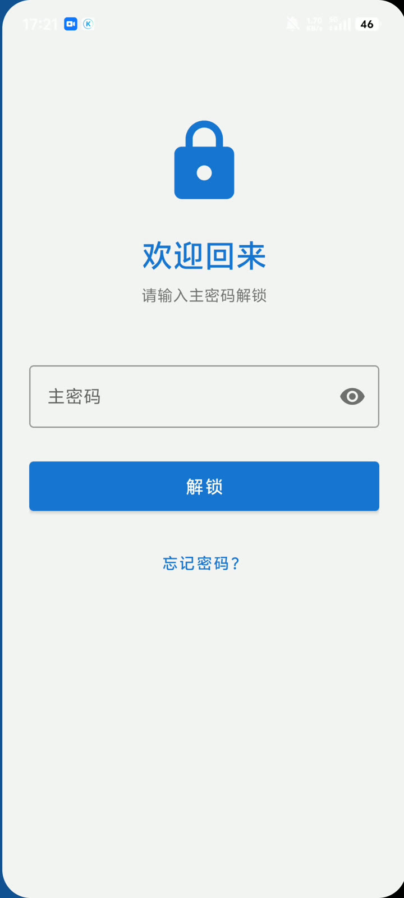
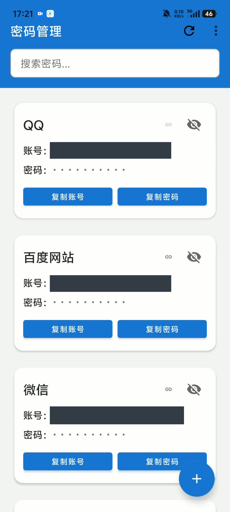
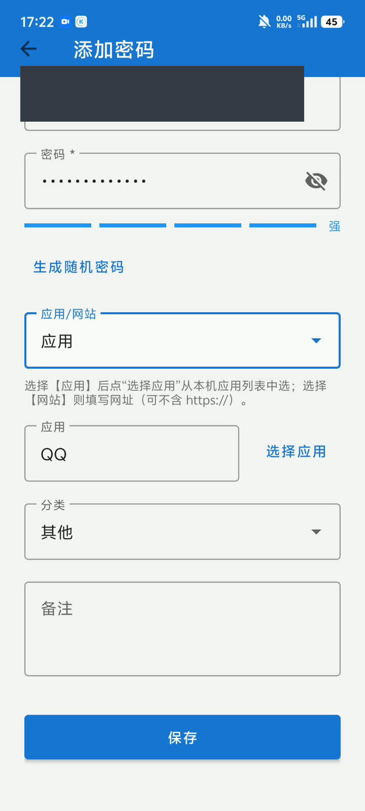
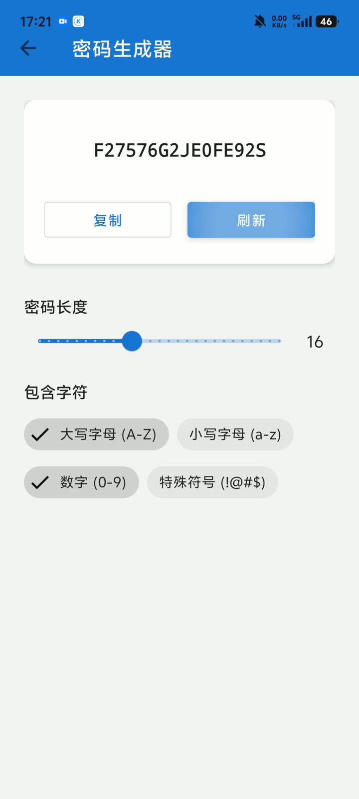
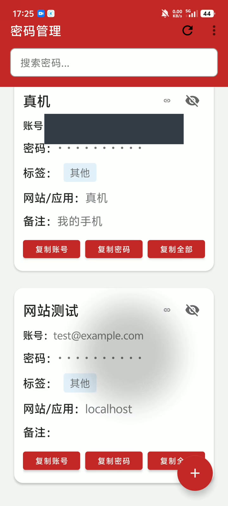
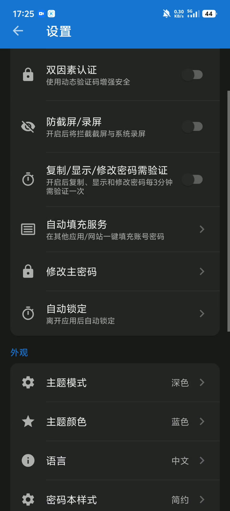
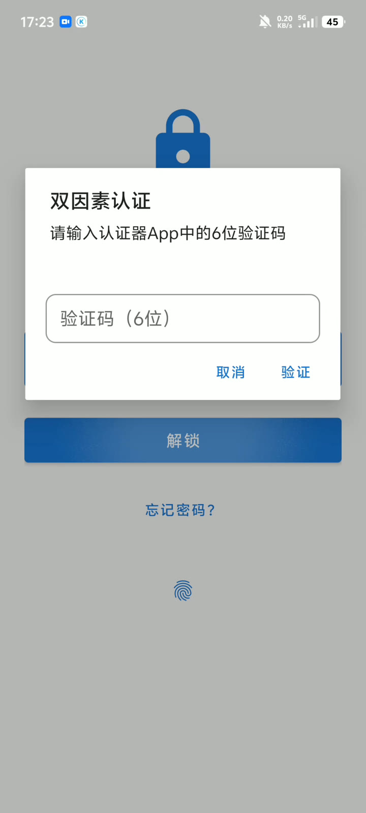
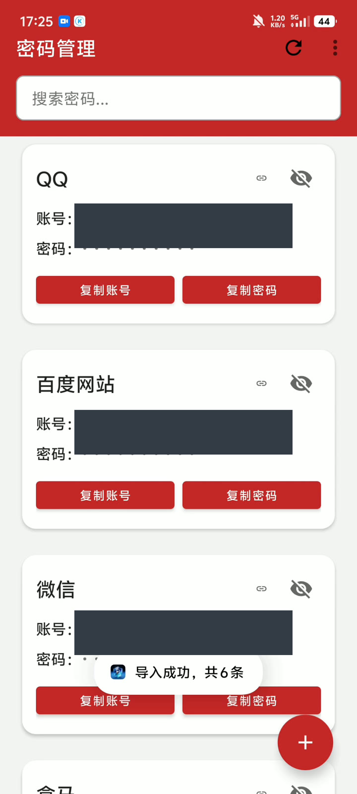

# 操作演示与截图说明

[返回 README](../README.md)

这里选取作者提供的早期真机录屏画面，补充说明“密码管理”小应用的使用过程。它们展示录制时的实际 UI，不是生成式效果图，也不替代当前公开源码的回归测试。账号等敏感内容已由素材处理环节做不透明遮盖；原始视频和未脱敏画面不进入仓库。

## 记录与查找

解锁后进入卡片列表，从右下角加号添加记录。表单包含标题、用户名/账号、密码、网站或应用、分类和备注；可以选择已安装应用作为条目归属。分类可选银行、社交、购物、邮箱、工作、游戏和其他。

| 主密码解锁（00:02.184） | 简约列表（00:08.476） | 应用绑定（00:27.630） |
| --- | --- | --- |
|  |  |  |

当前源码支持按标题或用户名搜索。公开版核心 UI 回归实际检查了新增→搜索→编辑返回，以及搜索词、记录创建时间和收藏元数据的保留；不能仅凭旧录像中有搜索框就视为搜索已测试。

## 生成密码与调整展示

密码生成器提供长度滑块和四类字符开关，点击刷新生成、复制取用。简约卡片强调基本信息，实用卡片则展示分类、网站/应用与备注。主题和语言可以在设置中切换。

| 密码生成（00:11.661） | 实用卡片（02:38.338） | 深色设置页（02:28.907） |
| --- | --- | --- |
|  |  |  |

录屏展示过浅色切换深色、蓝色切换红色、中英文切换、简约切换实用卡片。当前代码保留这些设置；未将全部主题色、字号和设备组合标为验收通过。设置画面中的自动填充与邮件备份入口属于旧版，当前不可用。

## 认证器二次验证

早期录像展示了认证器绑定、登录时输入六位动态验证码，以及错误验证码的反馈。当前源码保留 TOTP 功能；生物识别的系统认证画面有录屏黑屏，没有据此补画认证弹窗，也不把早期演示当作当前版本完整认证验收。

画面时间：01:05.184。当前进程重建后需要主密码，生物识别依赖有效内存会话；不要从早期指纹入口推断可以永久免主密码解锁。

## 文件备份与恢复

早期录像中，导出后清空了列表，再经系统文件选择器导入，界面提示“导入成功，共6条”，卡片重新出现。这只能证明当时画面的操作结果，未核对旧备份文件内容，也不代表当前 v3 格式已完成真机跨安装验收。

画面时间：02:56.369。当前格式已改为独立备份口令、导入前校验并在事务内追加写入；使用规则以 [README](../README.md#文件备份与恢复) 为准，不照搬旧录像中的口令与清空步骤。

## 当前版本与早期录像的差异

| 早期录像中的内容 | 当前公开版 |
| --- | --- |
| QQ、网页自动填充 | Manifest 已禁用服务，不作为当前功能展示。绑定应用/网站信息仍保留。 |
| 手动或定时邮件备份 | 关闭相关入口、旧任务和网络客户端；不上传外部邮箱画面，也不宣传调度可靠性。 |
| 文件导入恢复 | 已调整为 v3 独立备份口令；兼容旧 v2，当前恢复规则以 README 为准。 |
| 生物识别及动态验证码 | 保留实现；完整硬件、失败分支和生命周期组合仍待验收。 |
| 列表、生成器、主题、语言、卡片样式 | 当前源码保留；截图说明 UI 和早期交互，不作全设备兼容或性能承诺。 |

当前源码验证截图如下（API 36 模拟器、深色模式、虚构数据）：

测试日期、环境、已通过范围及剩余项目见[验证记录](VALIDATION.md)。本页所有时间戳均对应用户提供的加速视频，不能用于推算真实操作耗时。
