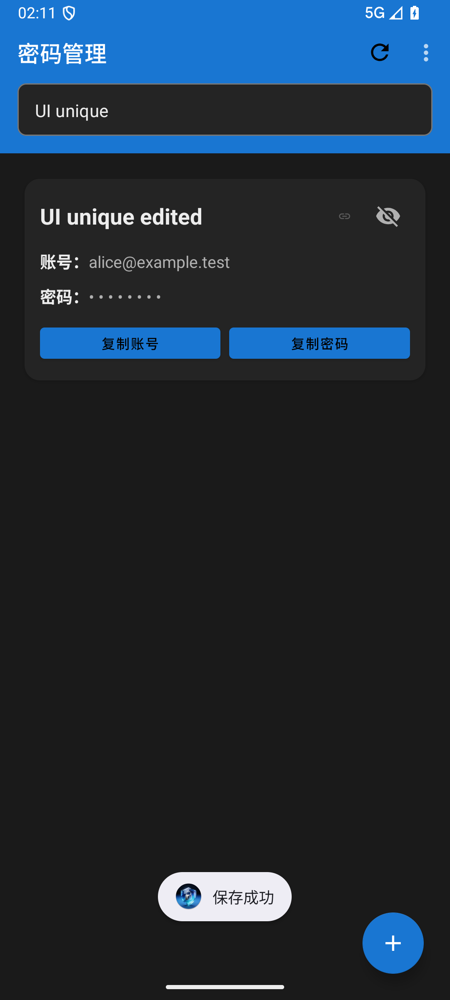

# 验证记录与当前限制

此文档记录开发验证版的实际检查范围，不代表所有 Android 设备均已通过测试。

## 已执行

验证日期：2026-10-17。环境：Windows、JDK 23、Android SDK 36；设备测试使用 Android 16 / API 36 模拟器。测试使用虚构账号、内存数据库或随机命名的测试库。

| 检查 | 结果 | 具体范围 |
| --- | --- | --- |
| Debug 构建 | 通过 | `:app:assembleDebug` |
| JVM 测试 | 20 项通过，无失败 | 19 项针对性测试及 1 项原模板；加解密、密码生成、备份格式和来源匹配 |
| Android 设备测试 | 9 项通过，无失败 | 8 项业务/界面测试及 1 项原模板；Room CRUD、SQLite v1→Room v2、条目/TOTP密文转换、改密、损坏数据回滚、文件恢复与核心UI |
| 核心界面单独回归 | 1 项再次通过 | 新增→搜索→编辑返回；检查搜索词、创建时间、收藏元数据及密码内容 |
| Lint | 0 错误，164 条警告 | 主要为无障碍描述、闲置资源、SharedPreferences 写入和配置建议；未用 baseline 隐藏告警 |
| 独立目录构建 | 通过 | 不携带原目录 local.properties、IDE文件和旧构建产物；使用同机 JDK/SDK/依赖缓存，不代表另一台全新机器 |

2026-10-18 上传前收尾仅调整公开说明、忽略规则和“关于”文案中的个人联系信息。整理后的白名单源码副本已在独立目录离线执行 `:app:assembleDebug`，结果通过（2026-10-18）。没有将先前测试结果标记为当天全部重新执行。

## 可复现命令

在配置好 JDK 和 Android SDK 的工程根目录执行：

```powershell
.\gradlew.bat :app:assembleDebug :app:testDebugUnitTest :app:lintDebug
# 仅连接用于测试的模拟器或设备时执行：
.\gradlew.bat :app:connectedDebugAndroidTest
```

对应报告由 Gradle 生成在 `app/build/reports/`、`app/build/test-results/` 和 `app/build/outputs/androidTest-results/`。这些目录不进入源码仓库；后续构建可能覆盖报告。

## 实际界面

下面为 API 36 模拟器深色模式下的虚构记录。已查看搜索框、记录卡片和复制按钮，没有明显遮挡；不代表全部主题与字号组合已检查。



## 尚未验收

- 真实手机及最低支持 API 28 的兼容性、JDK 17 独立环境构建。
- 主密码/生物识别/TOTP 的完整交互矩阵，以及锁屏、剪贴板和进程重建的全部组合。
- 系统文件选择器操作、真实旧安装覆盖升级、签名更新和跨安装人工恢复。
- 所有旧数据迁移中断节点、长文本、字体放大、其他主题及规模性能。
- 系统自动填充的端到端可信来源及响应缓存行为，因此本版完整关闭此服务。

当前定位为源码开发验证版。没有正式发布签名包，也没有第三方安全审计。密码字段与 TOTP 秘密加密，标题、账号、网站和备注等元数据仍为普通数据库字段；具体使用边界见 README。
